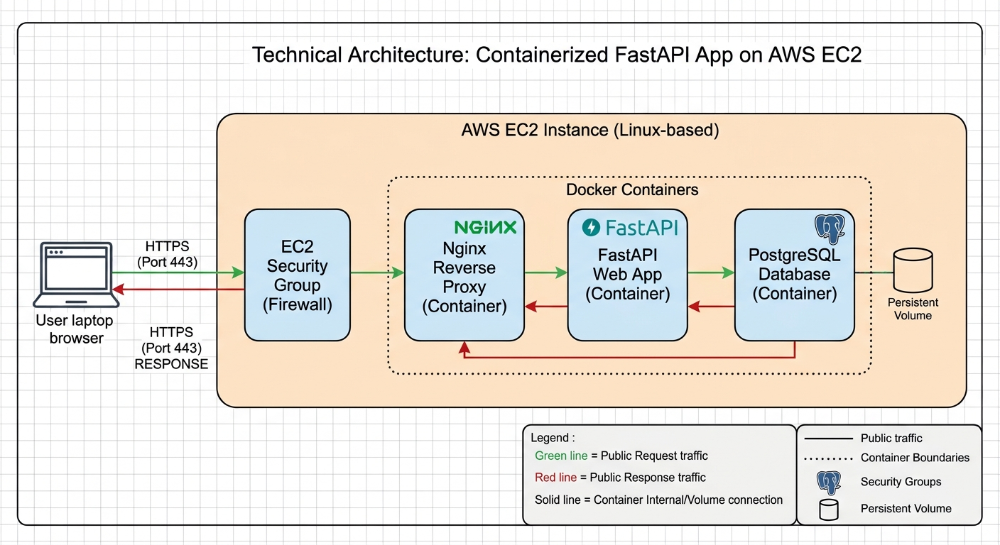

# FastAPI Guestbook Application

A full-stack guestbook application built with FastAPI, PostgreSQL, and Docker Compose, featuring automated CI/CD deployments to AWS EC2 via GitHub Actions and Nginx with automatic SSL management.

---

## Application Features & API Usage

The guestbook application provides a clean RESTful interface for visitors to leave messages, view past entries, and verify system status (running temporarily at [Cloud Guestbook Root](https://44.254.53.57.sslip.io):

- **Sign Guestbook:** Submit a new entry via `POST` at  `/sign`.
- **View Guestbook:** Retrieve and display all recorded guestbook entries via `GET` at `/list`.
- **Health Check API:** Verify that the FastAPI application and database connection are fully operational.

### API Endpoints & Health Check

You can test the health check endpoint locally with `curl`:

```bash
curl -X GET https://44.254.53.57.sslip.io/health
```

## Architecture Overview

The system architecture separates production public-facing edge routing (Nginx + Certbot) from internal core application services (`web` and `db`). 



### System Components

- **Web Application:** FastAPI app running on Python 3.11 with SQLAlchemy ORM and Psycopg 3.
- **Database:** PostgreSQL containerized with persistent host volume storage (`postgres_data`).
- **Reverse Proxy & SSL:** Nginx acting as the primary entry point, handling TLS termination and routing requests to FastAPI via internal Docker networking.
- **Certbot:** Automated SSL certificate issuance and renewal via Let's Encrypt.

---

## Tech Stack

- **Backend:** [FastAPI](https://fastapi.tiangolo.com/) + Uvicorn
- **Database:** PostgreSQL + [SQLAlchemy 2.0](https://www.sqlalchemy.org/)
- **Containerization:** Docker & Docker Compose
- **CI/CD:** GitHub Actions (SSH deployment pipeline)
- **Cloud Infrastructure:** AWS EC2 (Amazon Linux 2023), AWS CloudFormation IaC
- **Web Server:** Nginx + Certbot (Let's Encrypt)

---

## Getting Started (Local Development)

For local development, only the core application and database services are required. The production Nginx and Certbot layers can be safely bypassed.

### Prerequisites

- [Docker](https://docs.docker.com/get-docker/) & [Docker Compose](https://docs.docker.com/compose/) installed locally.

### Running the App Locally

1. **Clone the repository:**
   ```bash
   git clone https://github.com/cee-vance/guestbook.git
   cd guestbook
   docker compose up -d web db
   
2. **Build the container:**
   ```bash
   docker compose up -d web db
   
3. **Navigate to the app running on Development Server:**
   http://localhost:8000
   
